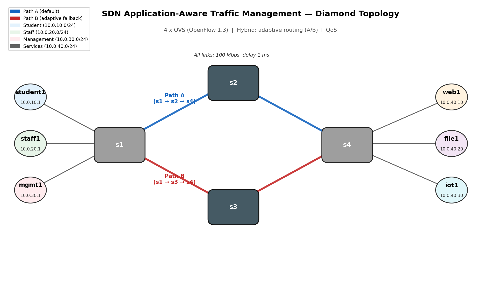

# Topology, IP and Port Mapping — FROZEN (Issue #3)

**Milestone:** M1 Design Complete
**Owner:** Member 1 (network/topology, IP/port mapping)
**Status:** ✅ Frozen 2026-11-03
**Reviewers:** All members

This document freezes the network topology, IP plan, OVS port mapping, the two
alternative paths (A/B), link capacities and the service endpoints. Every module
(controller, monitoring, QoS, traffic generators) **must** reference this document
so all parts agree.

---

## 1. Topology shape — Diamond, 4 switches

```
                       <=== PATH A ===>
                     ┌──── s2 ──────┐
                     │              │
   [sources] ── s1 ──┤              ├── s4 ── [services]
                     │              │
                     └──── s3 ──────┘
                       <=== PATH B ===>
```

- **s1** = ingress / aggregation switch (sources attach here)
- **s2, s3** = two parallel transit switches forming the A/B alternative paths
- **s4** = egress / aggregation switch (service endpoints attach here)

All switches are **OVS**, running **OpenFlow 1.3**.



*Figure 1: Frozen diamond topology. Sources on s1 (Student/Staff/Management), services on s4, transit Path A (s1-s2-s4) and Path B (s1-s3-s4), all links 100 Mbps.*

---

## 2. Switches and link map (all links 100 Mbps)

| Link | Path | Capacity | Type |
|------|------|----------|------|
| s1 – s2 | A (hop 1) | 100 Mbps | OVS internal link |
| s2 – s4 | A (hop 2) | 100 Mbps | OVS internal link |
| s1 – s3 | B (hop 1) | 100 Mbps | OVS internal link |
| s3 – s4 | B (hop 2) | 100 Mbps | OVS internal link |

- **Path A** = `s1 → s2 → s4`
- **Path B** = `s1 → s3 → s4`
- Default route is **Path A**; the controller switches to **Path B** adaptively under load (see architecture + controller issues).
- Both paths carry identical capacity so the switch is load-balanced, not capacity-change, in the adaptive experiments.

---

## 3. IP plan (RFC 1918)

| Subnet | Purpose | Gateway |
|--------|---------|---------|
| 10.0.10.0/24 | Student hosts | 10.0.10.254 (on s1) |
| 10.0.20.0/24 | Staff hosts | 10.0.20.254 (on s1) |
| 10.0.30.0/24 | Management hosts | 10.0.30.254 (on s1) |
| 10.0.40.0/24 | Service endpoints | 10.0.40.254 (on s4) |

**Host addresses:**

| Host | Role | IP | Subnet | Attached to |
|------|------|-----|--------|-------------|
| student1 | Student | 10.0.10.1/24 | 10.0.10.0/24 | s1 (port 1) |
| staff1 | Staff | 10.0.20.1/24 | 10.0.20.0/24 | s1 (port 2) |
| mgmt1 | Management | 10.0.30.1/24 | 10.0.30.0/24 | s1 (port 3) |
| web1 | Web / HTTP service | 10.0.40.10/24 | 10.0.40.0/24 | s4 (port 1) |
| file1 | File / backup service | 10.0.40.20/24 | 10.0.40.0/24 | s4 (port 2) |
| iot1 | IoT / sensor service | 10.0.40.30/24 | 10.0.40.0/24 | s4 (port 3) |

> The three source subnets mirror the security roles (Student/Staff/Management) so
> Access-Control Lists (Issue #4) are expressed on source subnet, keeping ACL flow
> rules simple and auditable.

### 3.1 Decision A — cross-subnet reachability (ARP proxy + L3 rewrite)

Hosts live in four `/24` subnets and use gateway `.254` on each. Because this is a
Layer-2 OVS fabric, the **controller acts as the gateway** for every subnet:

- **ARP Proxy Responder** — the controller answers ARP requests for each gateway
  address `10.0.10.254 / 10.0.20.254 / 10.0.30.254 / 10.0.40.254` with the edge
  switch's own MAC (e.g. s1 for the source subnets, s4 for the service subnets).
- **Edge MAC Rewrite (`set_field(eth_dst=…)` / `eth_src`)** — when routing between
  subnets, the controller rewrites the L2 header at the ingress edge (s1) to the
  destination host/service MAC and at the egress edge (s4), instead of flooding ARP
  across the diamond.
- **Loop-free install** — flow rules are installed along a single chosen path
  (Path A or Path B), never flooding broadcast across `s1-s2-s4-s3-s1`, so the
  physical L2 loop is never used for unknown/broadcast frames.

Consequences already reflected elsewhere in this repo:
- Every host sets `defaultRoute="via 10.0.<x>.254"` (done in `network/topology.py`)
  so cross-subnet packets leave the host OS stack toward the controller-gateway.
- Do **not** run `ryu.app.simple_switch_13` on this diamond: it only does L2 flooding
  (cannot route across `/24` and would cause an ARP/broadcast storm on the loop).
- The team's baseline / ARP-proxy controller (Issue #6+) implements this behaviour.

---

## 4. OVS port mapping

The controller installs flow rules keyed on these **physical/logical port numbers** so
traffic steering and monitoring refer to a stable, repeatable port map.

### s1 (ingress)
| Port | Connects to | Attached host / link |
|------|-------------|----------------------|
| 1 | student1 | 10.0.10.1 |
| 2 | staff1 | 10.0.20.1 |
| 3 | mgmt1 | 10.0.30.1 |
| 4 | s2 | Path A |
| 5 | s3 | Path B |

### s2 (transit — Path A)
| Port | Connects to |
|------|-------------|
| 1 | s1 (Path A in) |
| 2 | s4 (Path A out) |
| LOCAL | internal bridge port (OVS `LOCAL` = 4294967294), used for flow-stats/controller traffic |

### s3 (transit — Path B)
| Port | Connects to |
|------|-------------|
| 1 | s1 (Path B in) |
| 2 | s4 (Path B out) |
| LOCAL | internal bridge port (OVS `LOCAL` = 4294967294) |

### s4 (egress)
| Port | Connects to | Attached host / link |
|------|-------------|----------------------|
| 1 | web1 | 10.0.40.10 |
| 2 | file1 | 10.0.40.20 |
| 3 | iot1 | 10.0.40.30 |
| 4 | s2 | Path A |
| 5 | s3 | Path B |

> **Port stability note.** Port numbers above are **notification-order-independent**.
> In the MiniEdit/Mininet launch the controllers are started **before** hosts, so
> switch attachment order is deterministic and port numbers stay constant across
> repeated runs (required by Issue #5). In `network/topology.py` the ports are also
> **pinned explicitly** (`port1=`/`port2=`) to this table so Mininet can never
> reassign them.
>
> **Note on the OVS internal bridge port:** ports `s2`/`s3` connect two switches only;
> their internal bridge port is OVS `LOCAL` (number `4294967294`), not a numbered
> OpenFlow port. Don't reference an imaginary port `99` for these transit bridges.

---

## 5. Service endpoints and ports

| Service | Host | IP | L4 ports | Traffic class |
|---------|------|-----|----------|----------------|
| HTTPS / web browsing | web1 | 10.0.40.10 | TCP 443, 80 | Interactive |
| FTP / SFTP file transfer & backup | file1 | 10.0.40.20 | TCP 20, 21, 22 | Bulk |
| IoT / MQTT–SNMP telemetry | iot1 | 10.0.40.30 | UDP 5000–5100, UDP 161/162 | Periodic |

---

## 6. Redundancy and single point of failure

- **s1** and **s4** are single aggregation points by design (tested breadboard), so the
  A/B redundancy is confined to the **transit segment s2/s3**. This is the intended
  dimension for the adaptive-routing experiment.
- Link delay is set to a small constant (e.g. 1 ms) on all links so latency differences
  come from **queueing/load**, not physical path length, during baseline vs. adaptive
  comparison.

---

## 7. Cross-references

- Traffic classes + SLAs: `docs/requirements-slacls.md` (Issue #1)
- Architecture / data & control flow: `docs/architecture.md` (Issue #2)
- ACL / security matrix: `docs/security-policy.md` (Issue #4)
- Runnable topology: `network/topology.py`, `network/topology.mn` (Issue #5)
